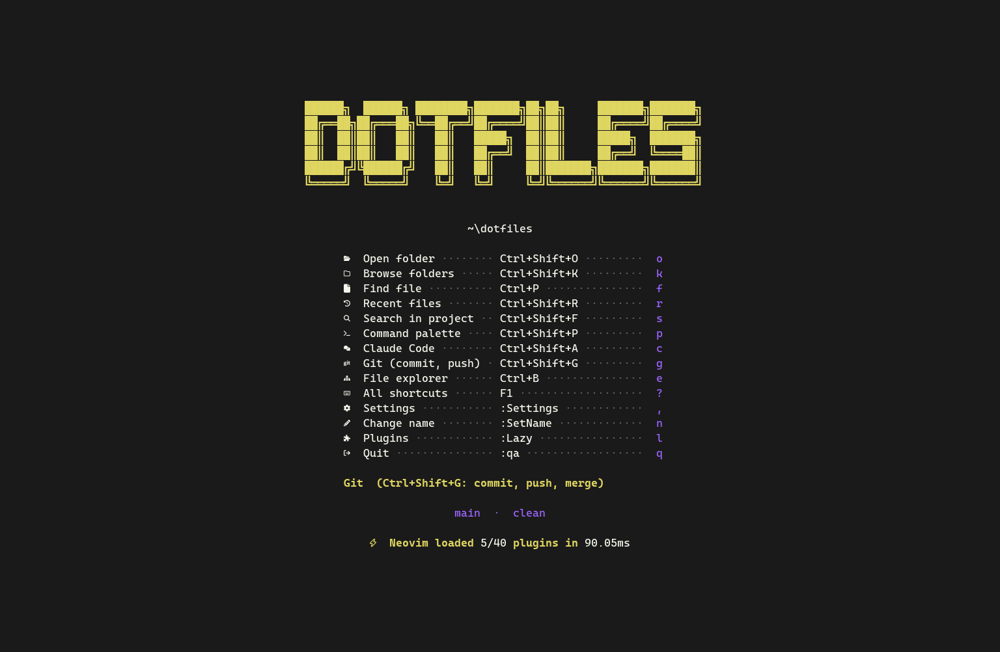
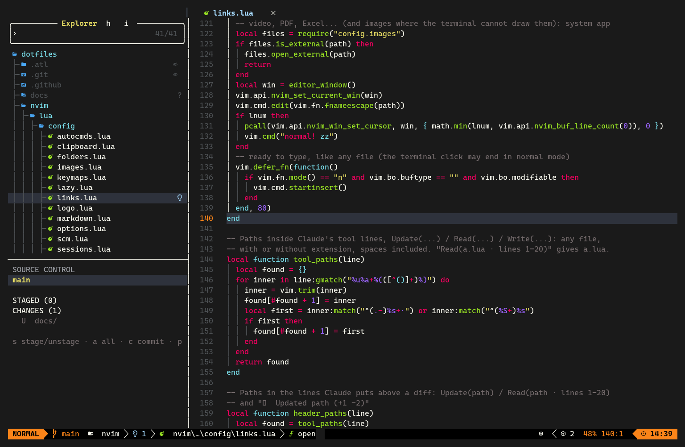
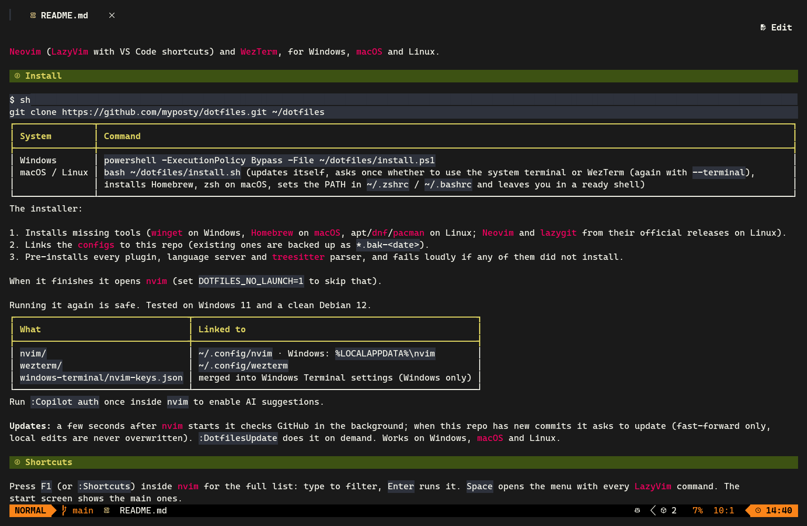
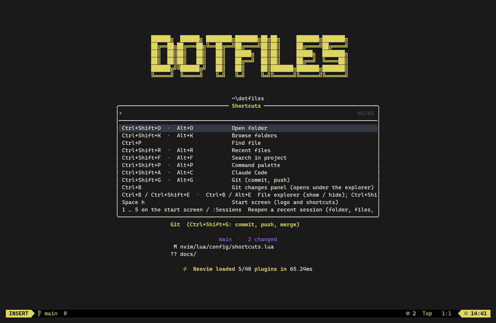

# dotfiles

Neovim (LazyVim with VS Code shortcuts) and WezTerm, for Windows, macOS and Linux.

| Start screen | Editor, explorer and git panel |
|---|---|
|  |  |
| **Markdown preview** (`Ctrl+Shift+V` / `Ctrl+K V`) | **All shortcuts** (`F1`) |
|  |  |
## Install

```sh
git clone https://github.com/myposty/dotfiles.git ~/dotfiles
```

| System | Command |
|---|---|
| Windows | `powershell -ExecutionPolicy Bypass -File ~/dotfiles/install.ps1` |
| macOS / Linux | `bash ~/dotfiles/install.sh` (updates itself, asks once whether to use the system terminal or WezTerm (again with `--terminal`), installs Homebrew, zsh on macOS, sets the PATH in `~/.zshrc` / `~/.bashrc` and leaves you in a ready shell) |

The installer:

1. Installs missing tools (winget on Windows, Homebrew on macOS, apt/dnf/pacman on Linux; Neovim and lazygit from their official releases on Linux).
2. Links the configs to this repo (existing ones are backed up as `*.bak-<date>`).
3. Pre-installs every plugin, language server and treesitter parser, and fails loudly if any of them did not install.

When it finishes it opens nvim (set `DOTFILES_NO_LAUNCH=1` to skip that).

Running it again is safe. Tested on Windows 11 and a clean Debian 12.

| What | Linked to |
|---|---|
| `nvim/` | `~/.config/nvim` · Windows: `%LOCALAPPDATA%\nvim` |
| `wezterm/` | `~/.config/wezterm` |
| `windows-terminal/nvim-keys.json` | merged into Windows Terminal settings (Windows only) |

Run `:Copilot auth` once inside `nvim` to enable AI suggestions.

**Updates:** a few seconds after nvim starts it checks GitHub in the background; when this repo has new commits it asks to update (fast-forward only, local edits are never overwritten). `:DotfilesUpdate` does it on demand. Works on Windows, macOS and Linux.

## Shortcuts

Press `F1` (or `:Shortcuts`) inside nvim for the full list: type to filter, `Enter` runs it. `Space` opens the menu with every LazyVim command. The start screen shows the main ones.

| Action | Windows | Linux | Mac | Any terminal |
|---|---|---|---|---|
| Find file | `Ctrl+P` | `Ctrl+P` | `Cmd+P` | `Ctrl+P` |
| Command palette | `Ctrl+Shift+P` | `Ctrl+Shift+P` | `Cmd+Shift+P` | `Alt+P` |
| Search in project | `Ctrl+Shift+F` | `Ctrl+Shift+F` | `Cmd+Shift+F` | `Alt+F` |
| Open folder (project list) | `Ctrl+Shift+O` | `Ctrl+Shift+O` | `Cmd+Shift+O` | `Alt+O` |
| Open folder by name (type to search) | `Ctrl+Shift+K` | `Ctrl+Shift+K` | `Cmd+Shift+K` | `Alt+K` |
| Recent files | `Ctrl+Shift+R` | `Ctrl+Shift+R` | `Cmd+Shift+R` | `Alt+R` |
| File explorer | `Ctrl+B` | `Ctrl+B` | `Cmd+B` | `Ctrl+B` (`Alt+E` also from Claude) |
| Close file | `Ctrl+W` | `Ctrl+W` | `Cmd+W` | `Ctrl+W` |
| Next / previous tab | `Ctrl+Tab` / `Ctrl+Shift+Tab` | `Ctrl+Tab` / `Ctrl+Shift+Tab` | `Cmd+Shift+]` / `Cmd+Shift+[` | `Alt+]` / `Alt+[` |
| Save (formats with Prettier; a new file asks for its name) | `Ctrl+S` | `Ctrl+S` | `Cmd+S` | `Ctrl+S` |
| New file | `Ctrl+N` | `Ctrl+N` | `Cmd+N` | `Ctrl+N` |
| What changed here (old lines in red, new in green) | `Alt+D` | `Alt+D` | `Option+D` | `Alt+D` |
| Undo / redo | `Ctrl+Z` / `Ctrl+Shift+Z` | `Ctrl+Z` / `Ctrl+Shift+Z` | `Cmd+Z` / `Cmd+Shift+Z` | `Ctrl+Z` / `Ctrl+Y` |
| Select all | `Ctrl+A` | `Ctrl+A` | `Cmd+A` | `Ctrl+A` |
| Toggle comment | `Ctrl+/` | `Ctrl+/` | `Cmd+/` | `Ctrl+/` |
| Multi-cursor on next match | `Ctrl+D` | `Ctrl+D` | `Cmd+D` | `Ctrl+D` |
| Move line | `Alt+Up/Down` | `Alt+Up/Down` | `Option+Up/Down` | `Alt+Up/Down` |
| Format document | `Shift+Alt+F` | `Shift+Alt+F` | `Shift+Option+F` | `Shift+Alt+F` |
| Rename / go to definition / references | `F2` / `F12` / `Shift+F12` | `F2` / `F12` / `Shift+F12` | `F2` / `F12` / `Shift+F12` | `F2` / `F12` / `Shift+F12` |
| Quick fix | `Ctrl+.` | `Ctrl+.` | `Cmd+.` | `Alt+.` |
| Problems panel | `Ctrl+Shift+M` | `Ctrl+Shift+M` | `Cmd+Shift+M` | `Alt+M` |
| Terminal show-hide | `Ctrl+J` | `Ctrl+J` | `Cmd+J` | `Ctrl+J` |
| New terminal | `` Ctrl+Shift+` `` | `` Ctrl+Shift+` `` | `` Cmd+Shift+` `` | `` Alt+` `` |
| Terminal show-hide (alternative) | `` Ctrl+` `` | `` Ctrl+` `` | `` Ctrl+` `` | `` Ctrl+` `` |
| Go to editor 1/2/3 / file explorer | `Ctrl+1/2/3` / `Ctrl+0` | `Ctrl+1/2/3` / `Ctrl+0` | `Cmd+1/2/3` / `Cmd+0` | `Alt+1/2/3` / `Alt+0` |
| Split editor | `Ctrl+\` | `Ctrl+\` | `Cmd+\` | `Ctrl+\` |
| Go to line | `Ctrl+G` | `Ctrl+G` | `Cmd+G` | `Ctrl+G` |
| Replace in file / in project | `Ctrl+H` / `Ctrl+Shift+H` | `Ctrl+H` / `Ctrl+Shift+H` | `Cmd+Option+F` / `Cmd+Shift+H` | `Ctrl+H` / `Alt+H` |
| Select line / all occurrences | `Ctrl+L` / `Ctrl+Shift+L` | `Ctrl+L` / `Ctrl+Shift+L` | `Cmd+L` / `Cmd+Shift+L` | `Ctrl+L` / `Alt+L` |
| New line below / above | `Ctrl+Enter` / `Ctrl+Shift+Enter` | `Ctrl+Enter` / `Ctrl+Shift+Enter` | `Cmd+Enter` / `Cmd+Shift+Enter` | `Ctrl+Enter` / `Ctrl+Shift+Enter` |
| Markdown: preview / edit (or click Preview) | `Ctrl+Shift+V` / `Ctrl+K V` | `Ctrl+Shift+V` / `Ctrl+K V` | `Cmd+Shift+V` / `Ctrl+K V` | `Alt+V` / `Ctrl+K V` |
| Toggle word wrap | `Alt+Z` | `Alt+Z` | `Option+Z` | `Alt+Z` |
| Next / previous match | `F3` / `Shift+F3` | `F3` / `Shift+F3` | `F3` / `Shift+F3` | `F3` / `Shift+F3` |
| Settings | `Ctrl+,` | `Ctrl+,` | `Cmd+,` | `Alt+,` |
| Resize panel | `Ctrl+Arrows` (or drag the border) | `Ctrl+Arrows` (or drag the border) | drag the border | drag the border |
| Git (lazygit) | `Ctrl+Shift+G` | `Ctrl+Shift+G` | `Cmd+Shift+G` | `Alt+G` |
| Claude Code panel | `Ctrl+Shift+A` | `Ctrl+Shift+A` | `Cmd+Shift+A` | `Alt+C` |
| Send selection or file to Claude | `Ctrl+Alt+K` | `Ctrl+Alt+K` | `Cmd+Option+K` | `Ctrl+Alt+K` |
| Start / end of line | `Home` / `End` | `Home` / `End` | `Cmd+Left` / `Cmd+Right` | `Home` / `End` |
| Previous / next word | `Alt+Left` / `Alt+Right` | `Alt+Left` / `Alt+Right` | `Option+Left` / `Option+Right` | `Alt+Left` / `Alt+Right` |
| Delete the previous word | `Alt+Backspace` | `Alt+Backspace` | `Option+Backspace` | `Alt+Backspace` |
| Accept Copilot suggestion | `Tab` | `Tab` | `Tab` | `Tab` |
| All shortcuts (type to filter) | `F1` | `F1` | `F1` | `F1` |

The **Any terminal** column works in every terminal. `Alt+P` is `Option+P` on a Mac.

Everywhere: click a file path in Claude or a terminal to open it (a numbered diff line opens at that line); `Space` opens every LazyVim command; with the explorer open, the Git changes panel sits under the file tree (`s` stage, `c` commit, `p` push, `P` pull).

**Images.** Copy an image and paste it into Claude with `Ctrl+V` / `Ctrl+Shift+V` (on Windows `Alt+V` also works). Images open inside nvim like in VS Code: as real images in WezTerm, kitty or ghostty, and drawn with colored blocks by chafa in any other terminal (Windows Terminal, Terminal.app, GNOME); `q` or `Ctrl+W` closes the tab. Video, PDF, Office and other files nvim cannot show open in the system app.

**Changes.** Lines changed since the last commit have a soft background (green added, blue modified, red where lines were removed) and reload by themselves when Claude or git changes the file.

**Explorer.** It follows the file you open, expanding the tree to it. `a` / `Ctrl+N` new file, `A` new folder (inside the selected folder), `r` rename, `d` delete, `c` copy, `m` move. It opens when you choose a project: a recent session on the start screen, or a folder from `Ctrl+Shift+O` / `Ctrl+Shift+K`.

**Sessions.** The start screen lists your recent sessions (`1` = the last one), `:Sessions` lists all of them. A session (folder, files, splits) is saved when you quit, and dotfiles updates restart nvim back to the same place.

**Mac.** The Mac column works in WezTerm. macOS Terminal.app (and other terminals) keep every `Cmd` key and send `Ctrl+Shift+X` as plain `Ctrl+X`, so there use the **Any terminal** column. `Option` works as `Alt` because `install.sh` turns on "Use Option as Meta" in Terminal.app. The start screen and `F1` show the keys that work in the terminal you are using.

**Windows.** In Windows Terminal, outside nvim, paste with `Ctrl+V`: `Ctrl+Shift+V` goes to nvim (markdown preview).

## Editing like VS Code

Files open ready to type: letters write text. `Esc` switches to Vim's command mode (letters run commands) and `i` goes back to typing. Saving, completion, auto-closing tags and brackets, and format on save (Prettier) work per language: TypeScript, Vue, Astro, Tailwind, PHP, Python, C/C++, Docker, YAML, TOML, Prisma and JSON.

## Customize

| What | File |
|---|---|
| Name on the start screen | Asked on the first start; change it with `:SetName` or `n` on the start screen. Stored per machine, not in this repo |
| Logo letters | `nvim/lua/config/logo.lua` |
| Shortcut list and start screen entries | `nvim/lua/config/shortcuts.lua` |
| Key bindings | `nvim/lua/config/keymaps.lua` |

## Tests

With the config installed (run the installer first), from the repo root:

```
nvim --headless -c "luafile tests/run.lua"
```

It prints `ok` / `FAIL` per test and exits non-zero on any failure. It checks the pure helpers (links, sessions, shortcut labels), the start screen layout, markdown preview, image files, runs every action of the shortcut list and every key mapping of `keymaps.lua` (pickers, windows and terminals are checked, not launched), and feeds each VS Code key and its Alt twin. GitHub Actions (`.github/workflows/test.yml`) lints the scripts, then runs the installer and this suite on Ubuntu, macOS and Windows for every push and pull request.

## Why the terminal config matters

Terminals send `Ctrl+Shift+O` as `Ctrl+O`, so Neovim cannot tell them apart. WezTerm and Windows Terminal are set to send those keys as CSI-u sequences when needed. In WezTerm this only happens while `nvim` is the active program; elsewhere the keys keep their WezTerm behavior.

## Requirements

Installed automatically: `nvim` ≥ 0.11, `git`, `rg`, `fd`, `lazygit`, `node`, `python3`, a C compiler and the `tree-sitter` CLI. macOS needs Homebrew first. On Windows, WezTerm loads fonts from `wezterm/fonts/` (not versioned); copy a Nerd Font there.
